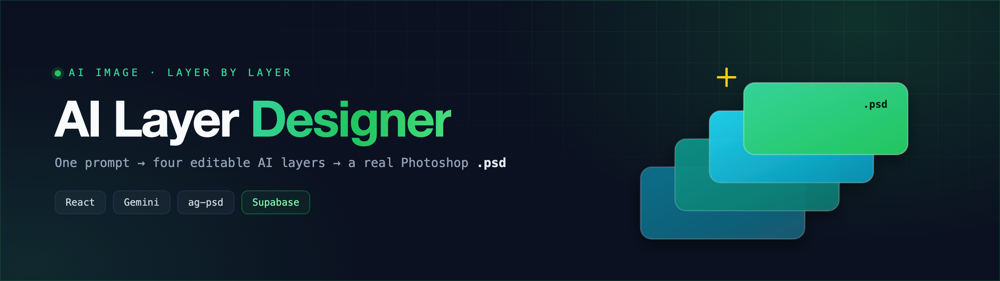
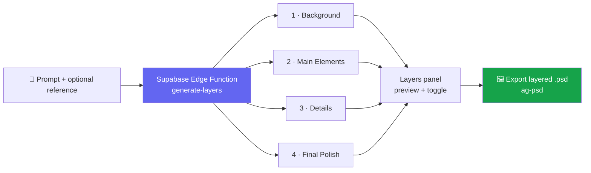

<div align="center">



<br/>

### Generate an image as four editable AI layers — then export it as a real Photoshop `.psd`.

Most AI image tools hand you a single flat picture. **AI Layer Designer** builds your image the way a designer actually works — **Background → Main Elements → Details → Final Polish** — and lets you download any stage, or the whole thing as a **layered `.psd`** you can keep editing in Photoshop.


</div>

---

## ✨ Why it's different

- **🧅 Layered, not flat.** Every generation returns **4 progressive layers**, not one image — so you can preview, toggle, and refine each stage independently.
- **🖼️ Real `.psd` export.** Layers are written into an actual Photoshop document with [`ag-psd`](https://github.com/Agamnentzar/ag-psd) (Background at the bottom, Final Polish on top) — open it in Photoshop, Affinity, or GIMP and keep working.
- **📌 Reference-image aware.** Drop in a reference and the model matches its style and composition.
- **⚡ One prompt → a full build.** Describe the scene once; the pipeline expands it into four targeted, build-on-each-other prompts.

## 🧩 How it works



A Supabase Edge Function calls **`google/gemini-2.5-flash-image-preview`** four times, each with a purpose-built prompt that builds on the previous layer:

| Layer | What it generates |
|-------|-------------------|
| **1 · Background** | Environment, base colors, atmosphere — no subjects yet |
| **2 · Main Elements** | Primary subjects, key objects, focal points |
| **3 · Details** | Textures, secondary elements, refined lighting |
| **4 · Final Polish** | Effects, highlights, shadows, color grading |

`psdExport.ts` then renders each layer onto a 1024×1024 canvas and writes a single `.psd` — layers reversed so Background sits at the bottom of the stack, with a generated thumbnail.

## 🚀 Features

- Four-layer progressive image generation from a single prompt
- Optional reference image for style & composition guidance
- Live layer-preview panel with per-layer toggles
- One-click **Photoshop `.psd`** export with true, editable layers
- Polished, dark-mode-ready UI — React + shadcn/ui + Tailwind

## 🛠️ Tech stack

| Area | Tools |
|------|-------|
| **Frontend** | React 18 · TypeScript · Vite |
| **UI** | Tailwind CSS · shadcn/ui (Radix) · lucide-react · sonner |
| **Backend** | Supabase Edge Functions (Deno) |
| **AI** | Gemini 2.5 Flash (image) via an OpenAI-compatible gateway |
| **Export** | [`ag-psd`](https://github.com/Agamnentzar/ag-psd) |

## 📦 Getting started

```bash
# 1 — install dependencies
npm install

# 2 — configure environment
cp .env.example .env      # fill in your Supabase values

# 3 — run the dev server
npm run dev               # http://localhost:5173
```

The `generate-layers` Edge Function needs a `LOVABLE_API_KEY` set as a Supabase secret:

```bash
supabase functions deploy generate-layers
supabase secrets set LOVABLE_API_KEY=your_key
```

### Environment variables

| Variable | Where | Purpose |
|----------|-------|---------|
| `VITE_SUPABASE_URL` | `.env` (client) | Supabase project URL |
| `VITE_SUPABASE_PROJECT_ID` | `.env` (client) | Supabase project id |
| `VITE_SUPABASE_PUBLISHABLE_KEY` | `.env` (client) | Supabase anon key (public) |
| `LOVABLE_API_KEY` | Supabase **Edge Function secret** | Auth for the image-model gateway |

> Want to use your own model? The function targets an OpenAI-compatible image endpoint — point it at any Gemini/OpenAI-compatible gateway by editing `supabase/functions/generate-layers/index.ts`.

## 🗂️ Project structure

```
src/
  components/ImageGenerator.tsx   # prompt + reference upload + generate
  components/LayersPanel.tsx      # preview & toggle the 4 layers
  utils/psdExport.ts              # build a layered .psd with ag-psd
  pages/Index.tsx                 # app shell + Layer type
supabase/
  functions/generate-layers/      # 4-pass progressive image generation
```

## 📄 License

[MIT](LICENSE) © Mohammed Abumtary

<div align="center"><sub>Built by <a href="https://github.com/Mohammed-AB">Mohammed Abumtary</a> · <a href="https://mohammed-ab.github.io">Portfolio</a></sub></div>
