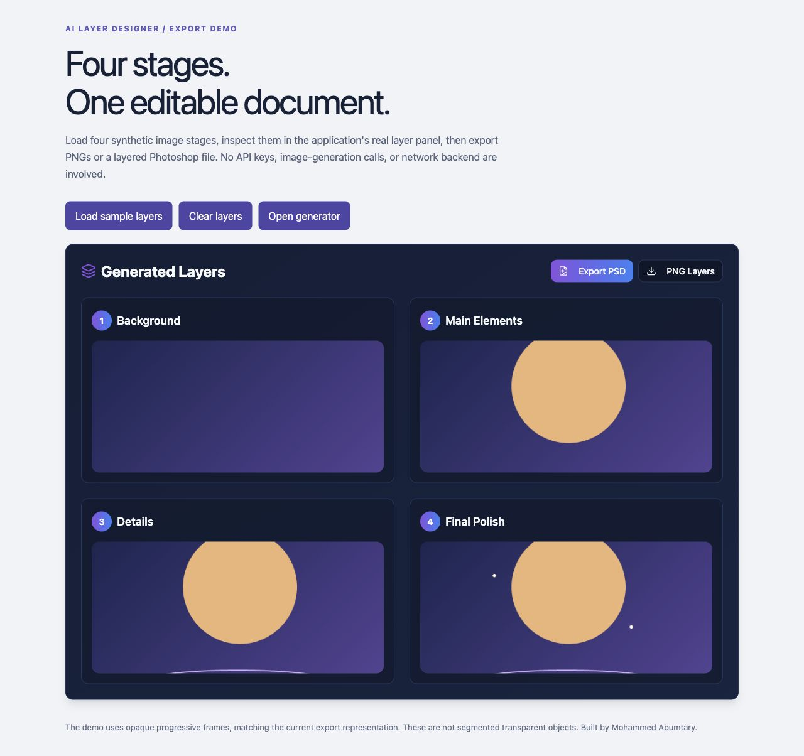
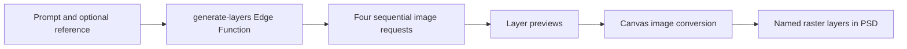

# AI Layer Designer

A four-stage image-generation prototype with a browser-based Photoshop exporter. Built by **Mohammed Abumtary**.

[Try the export demo](docs/DEMO.md) · [Configure generation](docs/SETUP.md) · [Architecture](docs/ARCHITECTURE.md) · [Portfolio](https://mohammed-ab.github.io/)



## Try the real export path, without an API key

With Node.js 22, after cloning:

```bash
npm ci
npm run demo
```

Open **http://127.0.0.1:8080/?demo**, select **Load sample layers**, then **Export PSD**. The four deterministic drawing fixtures use the same `LayersPanel` and `createPsdFromLayers` implementation as generated images. They are labeled synthetic; they are not model output.

## Engineering focus

- A Supabase Edge Function sends four sequential requests with stage-specific prompts: background, main elements, details and final polish.
- Each request can include the user's reference image.
- The UI inspects and downloads each stage.
- `ag-psd` writes named raster layers into a 1024×1024 Photoshop document, scaling and centering each source image.
- Model-provider credentials stay in the Edge Function; browser configuration contains only public Supabase values.



## What “layers” means here

The model produces four separate images. Earlier generated images are **not** fed into subsequent requests; each gets the original prompt/reference with a different stage instruction. The output is not guaranteed to align or contain transparent, independently segmented objects. Opaque upper layers can cover lower layers in Photoshop. The browser currently previews stages and downloads them; it does not implement a compositing editor or layer-visibility toggles.

This is an experimental image workflow and real raster-export implementation, not a claim of production usage or guaranteed model consistency.

## Read the implementation

| Concern | Source |
| --- | --- |
| Prompt and reference upload | [`ImageGenerator.tsx`](src/components/ImageGenerator.tsx) |
| Model calls and response parsing | [`generate-layers`](supabase/functions/generate-layers/index.ts) |
| Preview and downloads | [`LayersPanel.tsx`](src/components/LayersPanel.tsx) |
| PSD construction | [`psdExport.ts`](src/utils/psdExport.ts) |
| Synthetic export fixtures | [`Demo.tsx`](src/demo/Demo.tsx) |

React 18 · TypeScript · Vite · Supabase Edge Functions · ag-psd.

```bash
npm run typecheck
npm run build
```

[Verification record](docs/VALIDATION.md) · [Optional CI template](docs/verify-workflow.yml.example)

[MIT](LICENSE) © 2026 Mohammed Abumtary. Third-party packages retain their own licenses.
